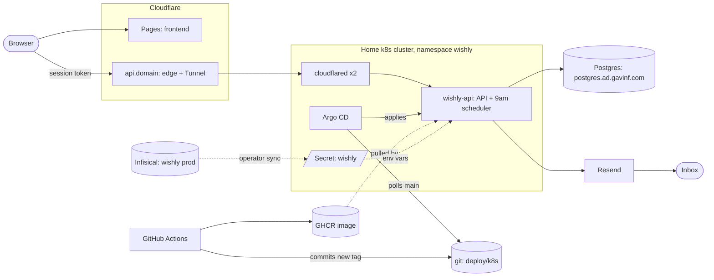

# Wishly infrastructure

How Wishly runs in production, why each piece is there, and how it all gets
built. The step-by-step commands live in the [README](../README.md); this doc
explains what those steps create and how the parts depend on each other.

## The system



| Piece | What it does | Where it's defined |
|---|---|---|
| **API image** | The whole app in one container: the FastAPI API, the session auth, and the scheduler thread that sends reminders at 9am Eastern. Tagged by commit SHA on GHCR. | `backend/`, `.github/workflows/api.yml` |
| **Kubernetes** | k3s at home. Runs `wishly-api` (1 replica) and `cloudflared` (2 replicas) in the `wishly` namespace, which enforces the `restricted` Pod Security level. | `deploy/k8s/` |
| **Argo CD** | Keeps the cluster matching `deploy/k8s` on `main`: applies changes, prunes what's removed, reverts hand edits. | `deploy/argocd/wishly.yaml` |
| **Postgres** | The only stateful piece. Postgres 18.4 in Docker on `postgres.ad.gavinf.com`, two roles. | `infra/postgres/compose.yaml`, `infra/sql/roles.sql`, `infra/sql/schema.sql` |
| **Cloudflare Tunnel + DNS** | Public HTTPS for `api.<domain>` with no open ports or public IP at home. Routes to the `wishly-api` Service. | `infra/terraform/tunnel.tf` |
| **The `wishly` Secret** | Every credential the pods use, in one Kubernetes Secret, built by the Infisical operator from Infisical (project `wishly-tg-hh`, env `prod`). | `deploy/k8s/infisical-secret.yaml` |
| **Terraform state** | S3 bucket, versioned, S3-native locking. Terraform itself manages only Cloudflare. | Created by hand (see README step 2) |
| **Resend** | Sends the emails, plain text. SaaS, configured in its dashboard. | — |

## Three paths through the system

**A user request.** Browser → `api.<domain>` (Cloudflare) → Tunnel → one of
the cloudflared pods → the `wishly-api` Service → the API pod. A NetworkPolicy
lets only cloudflared open connections to the API. The API hashes the session
token from the `Authorization` header, looks it up in `sessions`, then queries
Postgres as `wishly_app`. Auth lives in the API itself (no third-party
identity provider); see `backend/src/wishly/auth.py`.

**The daily send.** A thread inside the API wakes every quarter hour. From
9:00 Eastern until midnight Eastern, each tick sends whatever is due today: it
inserts a row into `sends` (the primary key lets exactly one attempt win), then
emails it through Resend. A failed send deletes its row, so the next tick, 15
minutes later, retries it. So the 9:00 tick does the work, and later ticks
retry failures and catch up after a restart. Two pods overlapping during a
rollout can't double-send, for the same reason.

**A deploy.** Merge to `main` → GitHub-hosted runner runs the tests and pushes
`ghcr.io/<owner>/wishly:<sha>` → the `release` job rewrites `newTag` in
`deploy/k8s/kustomization.yaml` and pushes that commit → Argo CD, polling
`main`, sees the change and applies it → Kubernetes starts the new pod, waits
for `/readyz`, then stops the old one (`maxUnavailable: 0`). CI never holds
cluster credentials; the cluster pulls.

## Secrets: where each one comes from and goes

Nothing secret is committed or baked into the image. The cluster's credentials
live in Infisical (project `wishly-tg-hh`, env `prod`); the Infisical operator copies
them into one Kubernetes Secret, `wishly`, and keeps it in sync. Each pod reads
only its own keys from it. Your password manager is the record of everything you made
by hand.

| Secret | Created by | Lives in | Read by |
|---|---|---|---|
| `WISHLY_DATABASE_URL` (`wishly_app` role) | You, when running `roles.sql` | `wishly` Secret, your password manager | The API |
| `wishly_schema` password | You, when running `roles.sql` | Your password manager | You, when applying `schema.sql` |
| Postgres superuser password | The first-start command (README step 4) | `/opt/postgres/.env` on the DB host (mode 0600) | You, when running `roles.sql` |
| `TUNNEL_TOKEN` | Terraform (Cloudflare) | Terraform state → `wishly` Secret | cloudflared |
| `WISHLY_RESEND_API_KEY` | Resend dashboard | `wishly` Secret, your password manager | The API |
| `WISHLY_CORS_ORIGINS` | Terraform (plain config, not secret) | `wishly` Secret | The API |
| `WISHLY_SIGNUP_ENABLED` | You (optional; `false` once your account exists) | `wishly` Secret | The API |
| Provider tokens (Cloudflare; AWS only for the state bucket) | Each dashboard | `infra/terraform/.env` (gitignored) | Terraform, from your shell's environment |

**Changing a secret** means editing it in Infisical. Within a minute the
operator updates the Secret and restarts both Deployments (they carry
`secrets.infisical.com/auto-reload`), since pods read environment variables
only at start.

**Argo CD leaves the Secret alone.** Argo creates the `InfisicalSecret`; the
operator creates and owns the Secret. After a cluster rebuild, the operator's
machine identity (homek8s) is the only thing to recreate by hand.

**Terraform state holds secrets.** The tunnel token sits in state, because
Terraform generated it; you copy it from its output into Infisical. That's why the state
bucket is private, versioned, and blocks all public access.

## Least privilege

- **Database roles.** The API connects as `wishly_app`
  (`pg_read_all_data` + `pg_write_all_data`): it can read and write rows but
  cannot create, alter, or drop tables. Only `wishly_schema` (owns the
  database) can change the schema, and only a person uses it.
- **Pods** run as non-root with a read-only filesystem, no Linux capabilities,
  no service-account token, and the runtime's default seccomp profile. The
  namespace's Pod Security level rejects anything less.
- **The API** accepts connections only from cloudflared (NetworkPolicy).
- **CI** can push images and commit to the repo, but has no access to the
  cluster or its Secret. Argo CD pulls from a public repo, so it needs no
  credentials either.
- **Postgres** accepts only password (scram-sha-256) logins over the network.
- **Nothing at home has an inbound port.** The tunnel dials out to Cloudflare.

## Build order, and why

Each step needs something the one before it made:

1. **Image** (CI on push): the cluster needs something to pull.
2. **State bucket** (by hand): Terraform can't store state in a bucket it hasn't
   made yet.
3. **Terraform apply**: tunnel and DNS, and the tunnel token the Secret needs.
4. **Database** (Compose on the DB host, then `roles.sql`, then `schema.sql`):
   tables must exist before the API serves traffic, and the Secret needs the
   `wishly_app` password.
5. **Cluster**: the keys in Infisical, then the Argo CD Application.
   From then on, merges deploy.
6. **Frontend** on Cloudflare Pages, pointed at `https://api.<domain>/v1`.

## When something fails

| Failure | What happens | What you see |
|---|---|---|
| Postgres down | `/healthz` stays 200; `/readyz` 503, so the pod leaves the Service | Errors from the API. Sends due today retry every 15 min until midnight Eastern. |
| The API pod crashes | Kubernetes restarts it (liveness on `/healthz`) | Usually nothing; Argo CD shows it Degraded if it can't recover. |
| The scheduler thread dies or stalls | Nothing notices | No emails, and no more `scheduled send` lines in the API's log. |
| Cluster or home network down | Cloudflare can't reach a tunnel connector | `api.<domain>` returns a Cloudflare error. Reminders due that day still go out if it's back before midnight Eastern. |
| One cloudflared pod down | The other carries traffic; the PodDisruptionBudget keeps one up through drains | Nothing. |
| Resend down | The send fails, its `sends` row is deleted | Retried every 15 min until midnight Eastern. |
| A deploy ships a broken image | The new pod never passes `/readyz`; the old one keeps serving (`maxUnavailable: 0`) | Argo CD shows the app Degraded. Revert the `deploy:` commit. |
| You change a secret | The Infisical operator updates it within a minute and restarts the pods one at a time | Nothing. |
| The DB host reboots | Docker restarts Postgres (`restart: unless-stopped`); the API's pool reconnects | A few seconds of errors, if anyone is using it. |
| The DB host's disk dies | Everything since the last backup is gone | There are no backups yet; see Known gaps. |
| Terraform state lost | — | Prevented: state is in versioned S3, never on a laptop. |

## Watching it

There's no external monitoring. Check by hand:

```bash
curl https://api.<domain>/readyz              # {"status":"ready"}
kubectl -n wishly logs deploy/wishly-api -f   # includes each "scheduled send: {...}"
```

Argo CD's UI shows whether the app is Synced and Healthy.

## Known gaps

- **No failover.** If the cluster or home network is down, so is Wishly.
- **No alerting.** Nothing tells you Wishly is down or the scheduler stopped;
  you find out by looking (or by a missing reminder).
- **No login rate limiting.** Passwords are slow to hash (scrypt), but nothing
  stops repeated guesses. Cloudflare rate limiting on `/v1/auth/login` would
  cover it.
- **One API replica.** It's also the scheduler. More replicas would be safe
  (the `sends` key) but each would run its own scheduler; not worth it at this
  scale.
- **No database backups.** Postgres is one Docker volume on one box. A nightly
  `pg_dump` to somewhere else (S3, a NAS) is the obvious next step.
- **Secrets aren't versioned.** The `wishly` Secret has no history; your
  password manager is the backup.

## History: v1's lost Terraform state

v1's state file lived on a laptop and was deleted with its directory. Terraform
then knew nothing about ~20 live AWS resources, so `terraform destroy` would
have done nothing while a failover watchdog kept trying (and failing) to start
ECS tasks every 15 minutes. The orphans were found by their `Project=wishly`
tags and deleted with the AWS CLI in dependency order (consumers before what
they consume, the VPC last). v2 onward keeps state in a versioned S3 bucket.
